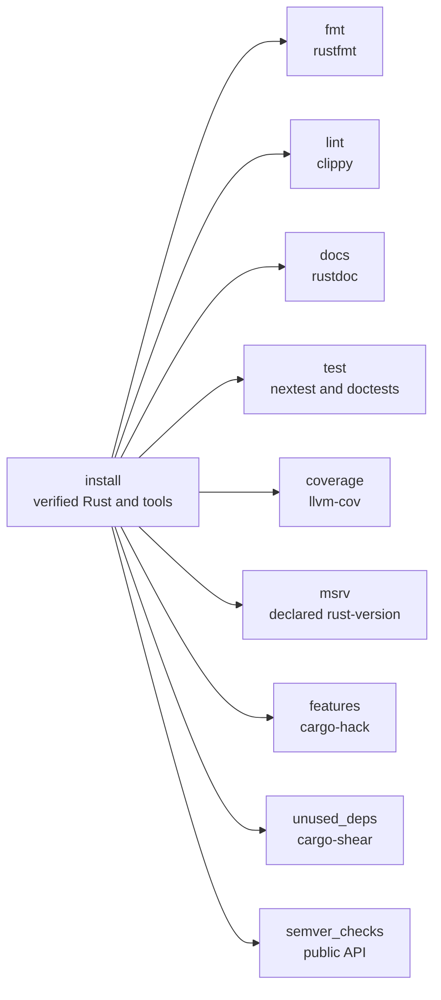

<div align="center">


# Rust Quality for CircleCI and GitHub Actions

### Hold Rust code to a standard on every commit: formatting, lints, docs, tests, coverage, MSRV, feature combinations, unused dependencies and semver.

Install a checksum-verified [Rust](https://www.rust-lang.org/) (a pinned release, or [rustup](https://rustup.rs/)), [cargo-nextest](https://nexte.st/), [cargo-llvm-cov](https://github.com/taiki-e/cargo-llvm-cov), [cargo-hack](https://github.com/taiki-e/cargo-hack), [cargo-shear](https://github.com/Boshen/cargo-shear) and [cargo-semver-checks](https://github.com/obi1kenobi/cargo-semver-checks), and gate builds on what rustfmt, clippy, rustdoc and they find, as orb commands or GitHub Actions.<br>
One exact Rust release, or rust-toolchain.toml · Each lint once, with SARIF · Tests split across nodes · Exact coverage gates · Every rust-version checked<br>
JSON, JUnit and run records · Findings told apart from code that doesn't compile · Strict SHA-512 verification by default · No `sudo`

[](https://circleci.com/gh/juburr/rust-quality-orb)
[](https://github.com/juburr/rust-quality-orb/actions/workflows/actions.yml)
[](https://circleci.com/developer/orbs/orb/juburr/rust-quality-orb)
[](LICENSE)
[](https://discuss.circleci.com/c/ecosystem/orbs)


**[Quick Start](#-quick-start)** · **[Features](#-why-rust-quality-orb)** · **[Recipes](#-recipes)** · **[Commands](#-commands)** · **[GitHub Actions](#-github-actions)** · **[Reports](#-reports)** · **[Security](#-secure-by-design)** · **[Network Access](#-network-access)**

<sub>An unofficial, community-maintained CircleCI orb and set of GitHub Actions. [Contributions are welcome!](#-contributing)</sub>

</div>

<br>

## ✨ Why rust-quality-orb?

<table>
<tr>
<td width="33%" valign="top">
🦀 <b>The Rust you choose, verified</b><br><br>
<code>install</code> with <code>rust</code> installs one exact release, without rustup, from its channel manifest, checked against this orb's checksum table, with every component checked against the manifest. With <code>rustup</code>, it installs a verified rustup and follows your <code>rust-toolchain.toml</code>. Or use the Rust your image ships.
</td>
<td width="33%" valign="top">
📎 <b>Every lint, not just the first crate's</b><br><br>
<code>lint</code> runs clippy with every lint capped at warning level, so a denied lint doesn't stop the build and hide the rest, then counts each one once, however many targets report it. Code that doesn't compile is an error, never a pass. SARIF links each lint to its documentation.
</td>
<td width="33%" valign="top">
🧪 <b>Tests that scale</b><br><br>
<code>test</code> runs cargo-nextest, each test in its own process, with JUnit, retries that name flaky tests, and <code>partition</code> to split the tests across CircleCI's parallel nodes, then the doctests nextest doesn't run. <code>coverage</code> gates on line coverage, compared exactly, never rounded.
</td>
</tr>
<tr>
<td width="33%" valign="top">
📏 <b>The rust-version you promise</b><br><br>
<code>msrv</code> checks each package with the Rust version its Cargo.toml declares, through rustup or a verified release installed beside the job's own, so a crate that started using <code>LazyLock</code> can't keep claiming 1.70.
</td>
<td width="33%" valign="top">
🧩 <b>Features and dependencies</b><br><br>
<code>features</code> builds every feature on its own, or every combination, with cargo-hack, on each target you name. <code>unused_deps</code> finds dependencies Cargo.toml declares but the code never uses, and ones in the wrong section, with cargo-shear.
</td>
<td width="33%" valign="top">
🏷️ <b>Semver before you publish</b><br><br>
<code>semver_checks</code> compares each library's public API with the last release, a git revision or a directory, and fails a change the version number doesn't allow, such as a removed function in a patch release.
</td>
</tr>
</table>

### 🧩 The Orb vs. a Hand-Rolled Script

| | `cargo install cargo-nextest` and friends | rust-quality-orb |
| --- | --- | --- |
| Tools | Whatever crates.io serves today, built by each job | Pinned releases, checked against SHA-512 checksums in the orb, and cached |
| Toolchain | Whatever the image's rustup resolves | One exact release, verified, or rustup and `rust-toolchain.toml`, or the image's: your choice |
| A tool that can't run | Exits 1 just as for findings, or 0 having checked nothing | Fails the step whatever `report_only` says, with the tool's own error |
| Fail-open traps | Easy to hit: a denied lint stopping clippy at the first crate, a nextest run with no tests, coverage rounded up to 100%, a semver check that skipped every package | Each one checked for and turned into a failure |
| Adoption | All or nothing | `report_only` on any check, and the findings still in the reports |
| Evidence | Logs | JSON, JUnit, SARIF and run records with SHA-256s of every input and report |

## 🔄 How It Works



1. `install` installs the toolchain and the tools a job needs, each checked against the orb's checksum table, or you use the Rust your image ships.
2. Each check runs on the workspace in `working_dir`, every member or the `packages` you name, and writes its reports.
3. Findings fail the step unless `report_only` is true. A check that couldn't run, such as one on code that doesn't compile, fails it always, so a broken check never reads as a clean one.

## 🚀 Quick Start

### CircleCI

```yaml
version: 2.1

orbs:
  rust-quality: juburr/rust-quality-orb@0.1.1

jobs:
  quality:
    docker:
      - image: cimg/rust:1.99.1
    steps:
      - checkout
      - rust-quality/install:
          tools: cargo-nextest
      - rust-quality/fmt
      - rust-quality/lint
      - rust-quality/docs
      - rust-quality/test

workflows:
  quality:
    jobs:
      - quality
```

### GitHub Actions

```yaml
name: Quality

on: push

permissions:
  contents: read

jobs:
  quality:
    runs-on: ubuntu-24.04
    steps:
      - uses: actions/checkout@v7
      - uses: juburr/rust-quality-orb/actions/install@v0.1.1
        with:
          tools: rust cargo-nextest
      - uses: juburr/rust-quality-orb/actions/fmt@v0.1.1
      - uses: juburr/rust-quality-orb/actions/lint@v0.1.1
      - uses: juburr/rust-quality-orb/actions/docs@v0.1.1
      - uses: juburr/rust-quality-orb/actions/test@v0.1.1
```

Each check writes its reports to `/tmp/rust-quality-reports` and stores them as artifacts, even when it fails. See [GitHub Actions](#-github-actions) for how the actions map to the orb's commands.

## 🍳 Recipes

### Adopt the Checks Gradually

Start a check with `report_only`, which writes every finding to the reports and the log without failing the step, then turn it off once the findings are fixed. A check that can't run, such as clippy on code that doesn't compile, still fails.

```yaml
- rust-quality/lint:
    report_only: true
```

### Pin One Rust Release, or Follow rust-toolchain.toml

`tools: rust` installs one exact release, without rustup, and puts it first on the `PATH`, ahead of an image's own Rust. The manifest it installs from is checked against this orb's checksum table, which covers every stable release from 1.56.0 on, and each component against the manifest.

```yaml
- rust-quality/install:
    tools: rust cargo-nextest cargo-llvm-cov
    rust_version: 1.99.1
    components: clippy,rustfmt,llvm-tools
```

`tools: rustup` installs a verified rustup instead, then the toolchain your `rust-toolchain.toml` names (with its components and targets), or `toolchain`'s, or stable.

```yaml
- rust-quality/install:
    tools: rustup cargo-nextest
```

The pinned release links with the system's C compiler, as rustup's toolchains do: cimg/rust, CircleCI's machine images and GitHub's runners have one.

### Split the Tests Across Nodes

With `partition`, each of the job's parallel nodes runs its share of the tests (nextest's `--partition hash:<node>/<total>`), and only the first runs the doctests. `retries` reruns a failing test; one that passes on a retry passes the step, with a warning that names it.

```yaml
jobs:
  test:
    docker:
      - image: cimg/rust:1.99.1
    parallelism: 4
    steps:
      - checkout
      - rust-quality/install:
          tools: cargo-nextest
      - rust-quality/test:
          partition: true
          retries: "2"
```

### Gate on Coverage

`coverage` runs the tests once on an instrumented build and fails below `coverage_min`, comparing covered lines to all lines exactly: 1999 of 2000 lines is below 100, however it rounds. It needs the `llvm-tools` component.

```yaml
- rust-quality/install:
    tools: rust cargo-llvm-cov cargo-nextest
    components: clippy,rustfmt,llvm-tools
- rust-quality/coverage:
    nextest: true
    coverage_min: "80"
    formats: lcov,cobertura,html
```

### Keep the rust-version Honest

`msrv` checks each package with the Rust version its Cargo.toml declares as `rust-version`, one `cargo check` per version. The toolchain comes from rustup when the job has it, or else is a verified release installed beside the job's own, which stays first on the `PATH`.

```yaml
- rust-quality/msrv
```

A `Cargo.lock` version 4 needs Rust 1.78 to read: for an older `rust-version`, keep version 3, which cargo writes for a new lockfile when `rust-version` is older than 1.78.

### Check Semver Before a Release

`semver_checks` compares each library package's public API with the newest release on crates.io, and fails a change the version bump doesn't allow. In pull requests, compare with the main branch instead:

```yaml
- rust-quality/semver_checks:
    baseline_rev: origin/main
```

Workspace members with `publish = false` are skipped unless `packages` names them.

### Check Feature Combinations and Targets

`features` builds each feature on its own (and with no features, the default ones and all of them), or every combination up to `depth` with `mode: feature_powerset`, on the machine's target and each one in `targets`, whose standard library the install adds.

```yaml
- rust-quality/install:
    tools: rust cargo-hack
    targets: wasm32-unknown-unknown
- rust-quality/features:
    mode: feature_powerset
    targets: wasm32-unknown-unknown
```

### Mark a Dependency cargo-shear Can't See Used

cargo-shear reads the source without compiling it, so it can miss a crate only a macro uses. List it in that package's Cargo.toml:

```toml
[package.metadata.cargo-shear]
ignored = ["serde_derive"]
```

### Upload clippy's Findings to GitHub Code Scanning

See [GitHub Actions](#-github-actions).

## 🧰 Commands

Run `install` before the other commands in the same job. The checks run whichever `cargo` comes first on the `PATH`: the one `install` installed, or the image's. Every check writes to `output_dir` (default `/tmp/rust-quality-reports`) and stores it as job artifacts under `rust-quality-reports/`, even when the step fails. Give each run of a command in a job its own `report_name`.

These parameters mean the same in every check that takes them:

| Parameter | Default | Description |
| --- | --- | --- |
| `working_dir` | `.` | Directory to run in: the root of the Cargo workspace or package, or any directory in it. |
| `packages` | *(empty)* | Workspace members to check, by package name, separated by commas or spaces. Empty means every member. |
| `features`, `all_features`, `no_default_features` | *(empty)*, `false`, `false` | cargo's feature selection, for the checks that build. |
| `locked` | `false` | Pass `--locked`, so cargo fails instead of changing a `Cargo.lock` that doesn't match `Cargo.toml`. |
| `extra_args` | *(empty)* | More arguments for the tool, split like shell words: nothing in them is expanded or run. Arguments a command sets itself are refused. |
| `output_dir`, `report_name`, `junit`, `run_record`, `report_only`, `store_artifacts` | | See [Reports](#-reports). |

String parameters expand environment variables (`$NAME`, `${NAME}`) with the CircleCI CLI, except `output_dir`, which is also passed to `store_artifacts`.

### `rust-quality/install`

Installs the tools named in `tools`, each verified against the orb's checksum table, through that tool's own install command (below), for amd64 or arm64 from `uname -m`.

| Parameter | Default | Description |
| --- | --- | --- |
| `tools` | `cargo-nextest,cargo-llvm-cov,cargo-hack,cargo-semver-checks,cargo-shear` | The tools to install, separated by commas or spaces: `rust` or `rustup` (not both), `cargo-nextest`, `cargo-llvm-cov`, `cargo-hack`, `cargo-semver-checks`, `cargo-shear`. An unknown name fails the step. The toolchain installs first. |
| `rust_version`, `rustup_version`, `cargo_nextest_version`, `cargo_llvm_cov_version`, `cargo_hack_version`, `cargo_semver_checks_version`, `cargo_shear_version` | `1.99.1`, `1.29.2`, `0.9.149`, `0.9.1`, `0.6.45`, `0.51.0`, `1.14.0` | Each tool's version, used when `tools` names it. |
| `components` | `clippy,rustfmt` | With `rust` or `rustup`, the components to install besides rustc, cargo and the standard library: `clippy` (for `lint`), `rustfmt` (`fmt`), `llvm-tools` (`coverage`), `rust-src`. |
| `targets` | *(empty)* | With `rust` or `rustup`, the targets to install the standard library for besides the machine's own. |
| `toolchain` | *(empty)* | With `rustup`, the toolchain to install, such as `stable` or `nightly-2026-10-01`. Empty installs the one `rust-toolchain.toml` names, or else stable. |
| `install_path` | `$HOME/.rust-quality-orb/bin` | Absolute path of the directory to install the cargo tools into, writable without root. Created if needed, and added to the `PATH` for later steps when it isn't already on it. The default isn't on any common executor's `PATH`, so it is put first, ahead of copies in `~/.cargo/bin`. |
| `rust_install_path` | *(see description)* | With `rust`, the installation's root, default `$HOME/.rust-quality-orb/rust`: it must be missing, hold no files, or be an earlier `install_rust` installation, which it replaces. With `rustup`, rustup's `CARGO_HOME`, default `CARGO_HOME` or `$HOME/.cargo`. |
| `verify_checksums` | `strict` | `strict`, `known_versions` or `false`, for every tool. See [Checksum Verification](#-checksum-verification). |
| `caching` | `true` | Cache each tool's verified download between jobs (for Rust, the manifest and component archives), keyed by tool, version, CPU architecture and home directory. A cached file is verified again before it is used. |
| `download_base_url` | *(empty)* | An `https://` mirror of GitHub releases, for the cargo tools, in place of `https://github.com`, serving the same paths. What it serves is still verified. Credentials (`user:password@`), a query and a fragment are refused, since they would show in the log. |
| `rust_download_base_url` | *(empty)* | The same, as a mirror of `https://static.rust-lang.org`, for Rust and rustup. With rustup, it also becomes `RUSTUP_DIST_SERVER` for the toolchains, unless that is set. |

### `rust-quality/install_<tool>`

`install_rust`, `install_rustup`, `install_cargo_nextest`, `install_cargo_llvm_cov`, `install_cargo_hack`, `install_cargo_semver_checks` and `install_cargo_shear` install one tool each, as `install` does, and take `version`, `install_path`, `verify_checksums`, `caching` and `download_base_url` with the same meaning (`install_rust` and `install_rustup` also take `components` and `targets`, and `install_rustup` takes `toolchain`). Use one to install a tool at a version of its own, or in a job that needs only that tool.

- `install_rust` installs rustc, cargo, the standard library and the `components` into `install_path` (default `$HOME/.rust-quality-orb/rust`), smoke-tests them, and only then replaces an earlier installation there. It warns when the directory it runs in has a `rust-toolchain.toml`, which only rustup reads.
- `install_rustup` runs the verified `rustup-init` with the minimal profile and no toolchain, then installs the toolchain and makes it the default.
- The five cargo tools are their static (musl) release binaries, which run on any Linux.

### `rust-quality/fmt`

Checks that every file is formatted as rustfmt would format it (`cargo fmt --check`), following `rustfmt.toml` and each package's edition, and reports the files it would change, with the diff. A file rustfmt can't parse fails the step whatever `report_only` says. Needs the `rustfmt` component. `extra_args` go to rustfmt, after `--`.

Writes `<report_name>.json` (the files) and `<report_name>.diff` (the changes); `report_name` defaults to `fmt`.

### `rust-quality/lint`

Runs clippy and reports every lint it and rustc find: the default ones, those the crates' attributes and Cargo.toml's `[lints]` turn on, and those `lint_args` adds. Lints run capped at warning level, so a lint the code denies doesn't stop the build at the first crate and hide the rest: each lint, at any level, is a finding. Code that doesn't compile fails the step whatever `report_only` says. Needs the `clippy` component.

| Parameter | Default | Description |
| --- | --- | --- |
| `lint_args` | *(empty)* | Lint options, such as `-W clippy::pedantic -A clippy::module_name_repetitions`, after `--`. `--cap-lints` is refused. |
| `all_targets` | `true` | Check tests, examples and benchmarks too (`--all-targets`). |
| `sarif` | `true` | Write `<report_name>.sarif`, with each lint linked to its documentation. |
| `report_name` | `clippy` | Writes `<report_name>.json` (the findings), `<report_name>.sarif` and `<report_name>.raw.jsonl` (cargo's messages). |

### `rust-quality/docs`

Builds the documentation (`cargo doc --no-deps`) and reports every lint rustdoc gives: broken intra-doc links, bare URLs, invalid code blocks and HTML, and `missing_docs` where a crate asks for it. Compiler warnings from the type-check cargo doc runs on the libraries other targets need are left to `lint`. `RUSTDOCFLAGS` and `build.rustdocflags` apply as set: a lint they deny stops rustdoc at that package and still counts as findings, not as a failure to build, and with cargo 1.74 or later the other packages are still documented. Code that doesn't compile, a build script that fails, or a package left undocumented fails the step whatever `report_only` says.

| Parameter | Default | Description |
| --- | --- | --- |
| `document_private_items` | `false` | Document private items too, whose links rustdoc then checks. |
| `report_name` | `docs` | Writes `<report_name>.json` and `<report_name>.raw.jsonl`. |

### `rust-quality/test`

Runs the tests with cargo-nextest, then the doctests, which nextest doesn't run, with `cargo test --doc`. Failing tests and code that doesn't build fail the step; a run in which no test ran does too, unless `no_tests` says otherwise. nextest's JUnit report is turned on with a tool config file; when the repository's `.config/nextest.toml` names another path for the profile, the step reads the report from there. Needs cargo-nextest.

| Parameter | Default | Description |
| --- | --- | --- |
| `profile` | `default` | The nextest profile, from `.config/nextest.toml`. |
| `filter` | *(empty)* | A nextest filterset choosing the tests (`-E`), such as `not test(slow)`. |
| `retries` | *(empty)* | How many times to retry a failing test; one that passes on a retry is flaky, which passes with a warning. |
| `no_tests` | `fail` | What to do when no test runs: `fail`, `warn` or `pass`. When `partition` splits the run, `fail` becomes `warn`, since a node's share can be empty. |
| `doctests` | `true` | Run the doctests too, on the first node only when `partition` splits the run. |
| `partition` | `false` | Split the tests across the job's parallel nodes (`--partition hash:<node>/<total>`). |
| `report_name` | `nextest` | Writes `<report_name>.json` (the counts and failing tests), `<report_name>.log`, `<report_name>.doctests.log`, and `junit/<report_name>/` with `nextest.xml` and `doctests.xml`. |

`test` has no `report_only`: a failing test fails the step.

### `rust-quality/coverage`

Measures line coverage with cargo-llvm-cov: the tests run once on an instrumented build, with `cargo test` or cargo-nextest, then each report is written from that run. Coverage below `coverage_min` is a finding; tests that fail, or don't build, leave no coverage to measure and fail the step whatever `report_only` says, and so does measuring no lines at all. The reports measure the packages the run tested, and `--release`, `--target`, `--doctests` and the build profile (`--profile`, or `--cargo-profile` with `nextest`) in `extra_args` go to them too. Needs cargo-llvm-cov and the `llvm-tools` component.

| Parameter | Default | Description |
| --- | --- | --- |
| `coverage_min` | *(empty)* | The lowest line coverage that passes, as a percentage such as `80` or `82.5`, compared exactly. Empty reports coverage without a minimum. |
| `nextest` | `false` | Run the tests with cargo-nextest. |
| `formats` | `lcov,cobertura` | Reports besides `<report_name>.json`: `lcov`, `cobertura`, `html`. |
| `ignore_filename_regex` | *(empty)* | Leave files whose path matches out of the reports and the total, such as generated code. |
| `report_name` | `coverage` | Writes `<report_name>.json` (llvm-cov's summary), `<report_name>.lcov`, `<report_name>.cobertura.xml` and `<report_name>-html/`. |

### `rust-quality/msrv`

Checks each package with the Rust version its Cargo.toml declares as `rust-version` (or with `rust_version`): `cargo check`, one run per version, on the packages that declare it, with that toolchain's own rustc whatever comes first on the `PATH`. A package that doesn't build on its version (rustc or a build script fails, or a dependency needs a newer Rust) is a finding; a toolchain that can't be installed, or a check that fails for another reason, such as a dependency that can't be fetched, fails the step whatever `report_only` says.

| Parameter | Default | Description |
| --- | --- | --- |
| `rust_version` | *(empty)* | The version to check every selected package with, such as `1.70`. Empty uses each package's own, and skips packages that declare none. |
| `toolchain_source` | `auto` | `rustup` (`rustup toolchain install`), `rust` (a verified release from this orb's table, 1.56.0 or newer, as `install_rust` installs it, into a directory of the step's own), or `auto`: `rustup` when rustup is on the `PATH`. |
| `all_targets` | `false` | Check tests, examples and benchmarks too. Off by default: their dev-dependencies often need a newer Rust than the crate. |
| `verify_checksums`, `download_base_url`, `caching` | `strict`, *(empty)*, `true` | With `toolchain_source: rust`, as for `install_rust`. A version given without a patch release (`1.70`) installs the newest one in the table. |
| `report_name` | `msrv` | Writes `<report_name>.json` and `<report_name>-<version>.log`. |

### `rust-quality/features`

Checks that each package builds with every feature on its own, or every combination of them, with cargo-hack: one run per target, with `--keep-going` so one combination that fails doesn't hide the rest. A combination that rustc, a build script or a test fails is a finding; cargo-hack failing, or a combination failing for another reason (a target whose standard library isn't installed, a download), fails the step whatever `report_only` says. Needs cargo-hack.

| Parameter | Default | Description |
| --- | --- | --- |
| `mode` | `each_feature` | `each_feature` (each feature on its own, and with no features, the default ones and all of them) or `feature_powerset` (every combination up to `depth`). |
| `depth` | `2` | With `feature_powerset`, the most features combined. Empty combines all of them, which grows exponentially. |
| `subcommand` | `check` | `check`, `clippy`, `build` or `test`. |
| `no_dev_deps` | `true` | Leave dev-dependencies out, so their features don't hide a combination that only builds with them. Only with `check` or `build`. |
| `skip_features` | *(empty)* | Features never to enable. |
| `targets` | *(empty)* | Targets to check besides the machine's own, each with its standard library installed. |
| `report_name` | `features` | Writes `<report_name>.json` (each combination and its result) and `<report_name>.log`. |

### `rust-quality/unused_deps`

Finds dependencies Cargo.toml declares that the code never uses, dependencies in the wrong section (a dev-dependency the library uses, for example), and source files no module includes, with cargo-shear, which parses the source without compiling it. Its errors are findings, and its warnings too with `deny_warnings`. cargo-shear failing fails the step whatever `report_only` says. Needs cargo-shear.

| Parameter | Default | Description |
| --- | --- | --- |
| `deny_warnings` | `false` | Count cargo-shear's warnings (empty files, unused optional dependencies) as findings too. |
| `report_name` | `unused-deps` | Writes `<report_name>.json` (cargo-shear's report, with each finding's line and column) and `<report_name>.log`. |

### `rust-quality/semver_checks`

Checks each library package's public API against a baseline for changes semver says need a new major (or minor) version, with cargo-semver-checks: by default the newest release on crates.io. A failed lint is a finding; lints set to warn are reported without failing. cargo-semver-checks failing, or checking no package at all, fails the step whatever `report_only` says. Needs cargo-semver-checks, whose release must read the toolchain's rustdoc JSON, which changes format every few Rust releases: 0.51.0 reads that of Rust 1.97 to 1.99.

| Parameter | Default | Description |
| --- | --- | --- |
| `baseline_rev` | *(empty)* | A git revision to compare with, such as `origin/main` or a release tag. |
| `baseline_version` | *(empty)* | A version from the registry to compare with. |
| `baseline_root` | *(empty)* | A directory holding the baseline's source. |
| `release_type` | *(empty)* | `major`, `minor` or `patch`, instead of the release the version bump implies. |
| `report_name` | `semver-checks` | Writes `<report_name>.json` (each package and the lints that failed or warned) and `<report_name>.log`. |

Set at most one of `baseline_rev`, `baseline_version` and `baseline_root`.

## ⚡ GitHub Actions

Each of the orb's commands has a GitHub Action of the same name. The actions run the same scripts as the orb, so they check the same things the same way, and take the same inputs with the same defaults.

| Action | Orb command |
| --- | --- |
| `juburr/rust-quality-orb/actions/install@v0.1.1` | [`rust-quality/install`](#rust-qualityinstall) |
| `juburr/rust-quality-orb/actions/install_rust@v0.1.1`, `install_rustup`, `install_cargo_nextest`, `install_cargo_llvm_cov`, `install_cargo_hack`, `install_cargo_semver_checks`, `install_cargo_shear` | [`rust-quality/install_<tool>`](#rust-qualityinstall_tool) |
| `juburr/rust-quality-orb/actions/fmt@v0.1.1` | [`rust-quality/fmt`](#rust-qualityfmt) |
| `juburr/rust-quality-orb/actions/lint@v0.1.1` | [`rust-quality/lint`](#rust-qualitylint) |
| `juburr/rust-quality-orb/actions/docs@v0.1.1` | [`rust-quality/docs`](#rust-qualitydocs) |
| `juburr/rust-quality-orb/actions/test@v0.1.1` | [`rust-quality/test`](#rust-qualitytest) |
| `juburr/rust-quality-orb/actions/coverage@v0.1.1` | [`rust-quality/coverage`](#rust-qualitycoverage) |
| `juburr/rust-quality-orb/actions/msrv@v0.1.1` | [`rust-quality/msrv`](#rust-qualitymsrv) |
| `juburr/rust-quality-orb/actions/features@v0.1.1` | [`rust-quality/features`](#rust-qualityfeatures) |
| `juburr/rust-quality-orb/actions/unused_deps@v0.1.1` | [`rust-quality/unused_deps`](#rust-qualityunused_deps) |
| `juburr/rust-quality-orb/actions/semver_checks@v0.1.1` | [`rust-quality/semver_checks`](#rust-qualitysemver_checks) |

The per-tool install actions are `juburr/rust-quality-orb/actions/install_rust@v0.1.1`, `juburr/rust-quality-orb/actions/install_rustup@v0.1.1`, `juburr/rust-quality-orb/actions/install_cargo_nextest@v0.1.1`, `juburr/rust-quality-orb/actions/install_cargo_llvm_cov@v0.1.1`, `juburr/rust-quality-orb/actions/install_cargo_hack@v0.1.1`, `juburr/rust-quality-orb/actions/install_cargo_semver_checks@v0.1.1` and `juburr/rust-quality-orb/actions/install_cargo_shear@v0.1.1`.

To upload clippy's findings to GitHub code scanning (the job needs `permissions: security-events: write`), point the upload at the SARIF report:

```yaml
      - uses: juburr/rust-quality-orb/actions/lint@v0.1.1
        with:
          report_only: "true"
      - uses: github/codeql-action/upload-sarif@v4
        with:
          sarif_file: /tmp/rust-quality-reports/clippy.sarif
          category: clippy
```

How they differ from the orb's commands:

- **Versions.** An action is referenced by the repository's release tag, such as `v0.1.1`, the same tag the orb is published from. There is no moving major tag yet. For the strongest pinning, use the tag's commit SHA: `juburr/rust-quality-orb/actions/lint@<sha> # v0.1.1`.
- **Inputs are strings.** Write booleans and numbers quoted, such as `report_only: "true"`.
- **Environment variables.** The orb expands `$NAME` in its parameters with the CircleCI CLI, which GitHub's runners don't have, so the actions take values as they are. Use GitHub's expressions instead, such as `rust_version: ${{ vars.RUST_RELEASE }}`.
- **Splitting tests.** `partition` reads CircleCI's `CIRCLE_NODE_TOTAL` and `CIRCLE_NODE_INDEX`. On GitHub, set them in the job's `env` from a matrix to split the tests the same way.
- **Artifacts.** A command that stores artifacts uploads `output_dir` with [`actions/upload-artifact`](https://github.com/actions/upload-artifact), even when the step fails, as an artifact named `rust-quality-reports-<report_name>-` and a random suffix, since artifact names must be unique in a workflow run. JUnit files are in `output_dir/junit/`, for any JUnit report action.
- **Caching.** `caching` stores each tool's verified download with [`actions/cache`](https://github.com/actions/cache), with the same key ingredients as the orb. The cache is restored before the install and saved right after it, and what it restores is verified again. It counts toward the repository's GitHub Actions cache storage.
- **Exports.** What a command exports to later steps (`PATH` entries, `CARGO_HOME`, `RUSTUP_HOME`, `RUSTUP_DIST_SERVER`) is passed on through `GITHUB_PATH` and `GITHUB_ENV`. GitHub's runners come with rustup; `install` with `rust` puts the pinned release first on the `PATH`, ahead of it.
- **Runners.** CI runs every action on GitHub-hosted `ubuntu-24.04` and `ubuntu-24.04-arm` runners.

The actions are composite actions in [`actions/`](actions), next to the orb's source. Each passes its inputs to the orb's script as environment variables, never pasting them into a script, and [`actions/run_script.sh`](actions/run_script.sh) gives the script what CircleCI would: a `BASH_ENV` file for the values it hands to later steps, which it then passes on through `GITHUB_PATH` and `GITHUB_ENV`.

## 📄 Reports

| Parameter | Default | Description |
| --- | --- | --- |
| `output_dir` | `/tmp/rust-quality-reports` | Absolute path of the directory for the reports. |
| `report_name` | *(per command)* | The reports' file name, without extension. A run removes what an earlier run with the same name left there first. |
| `junit` | `true` | Also write JUnit XML, and on CircleCI store it with `store_test_results`, for the Tests tab. |
| `run_record` | `false` | Also write `<report_name>.run-record.json`. See below. |
| `report_only` | `false` | Report findings without failing the step. A tool that can't complete still fails it. (`test` has none.) |
| `store_artifacts` | `true` | Store `output_dir` as artifacts under `rust-quality-reports/` (on GitHub, upload it as an artifact), even when the step fails. |

| Report | Written by |
| --- | --- |
| JSON | Every check: the orb's summary of what it found, with paths relative to the workspace root |
| SARIF 2.1.0 | `lint`: every clippy and rustc lint, linked to its documentation, for code scanning tools |
| JUnit XML | Every check: a failing test case per finding, and a passing one when there are none; nextest's own report and the doctests' for `test` |
| LCOV, Cobertura, HTML | `coverage`, as `formats` asks |
| Diff | `fmt`: the changes rustfmt would make |
| Logs | `test`, `coverage`, `msrv` (one per Rust version), `features`, `unused_deps`, `semver_checks`: the tool's own output, and cargo's messages as JSON for `lint` and `docs` |
| Run record | Every check with `run_record` |

A run record is a JSON document, described by [`schemas/run-record.v1.json`](schemas/run-record.v1.json), that says exactly what a check did, so a reviewer can tell without running it again: the command and its outcome, the CI job (CircleCI or GitHub Actions), the tool that ran with its SHA-512 and how the orb installed it, its arguments, the toolchain (cargo, `rustc -vV`, the rustup toolchain, and the settings that change what cargo builds, such as `RUSTFLAGS`), every input (`Cargo.lock`, `rust-toolchain.toml`, each member's `Cargo.toml`, the tool's config) and report with its SHA-256, and per test, version, combination or package results. Fields are only ever added within version 1.

## 🔒 Secure by Design

- **Least Privilege**: Installs to user-owned directories by default, Rust included, with no `sudo` usage anywhere in this orb. Everything runs as the job's user.
- **Integrity**: SHA-512 checksum validation of every tool, on by default and failing closed: a version this orb has no checksum for is refused before anything is downloaded, and a download that doesn't match is never installed. For Rust, the table pins the release's channel manifest, and every component is checked against the SHA-256 the manifest lists for it, from the cache too. See [Checksum Verification](#-checksum-verification).
- **Fail closed**: a tool that can't complete fails the step even with `report_only`, and so do the ways these tools pass while checking nothing: a clippy or rustdoc build that stopped on code that doesn't compile or a failing build script, a package cargo doc never documented, a nextest run with no tests, a test run that failed under coverage or one that measured no lines, a feature combination or Rust version that failed for a reason other than the code, and a cargo-semver-checks run that checked no package.
- **Confidentiality**: No check needs a secret. `extra_args` and the lists are split without running anything in them, so a value that reached one through an environment variable, such as a branch name, can't run a command. Mirror URLs with credentials, a query or a fragment are refused before they reach the log, and run records drop them from arguments. The GitHub Actions pass inputs to the scripts as environment variables, never pasting them into a script, and pin every action they use to a commit SHA.
- **Privacy**: No usage data of any kind is collected or shipped back to the orb developer.

> [!IMPORTANT]
> **Info for security teams:** see [Network Access](#-network-access) for every host the orb contacts, and what turns each off. The checks build and run your code, and its build scripts and proc macros, as any `cargo build` does: run them on pull requests from forks only as you would run `cargo test`.

## 💻 Supported Platforms

Linux executors and runners on `x86_64` (amd64) and `aarch64`/`arm64` (arm64), including CircleCI [Arm resource classes](https://circleci.com/docs/using-arm/) and GitHub's `ubuntu-24.04-arm` runners. macOS and Windows aren't supported yet: `install` fails on them rather than install a binary that can't run. CI runs every command on `cimg/rust:1.99.1` (Docker, amd64) with the pinned Rust and with the image's rustup, installs rustup on `cimg/base`, installs and runs the checks on an Arm Docker executor and on a machine executor without Rust, and runs every action on GitHub's amd64 and arm64 runners.

The scripts need bash 4 or newer, `jq`, `awk`, `tar`, `gzip`, `curl` or `wget`, and the standard coreutils, including `mktemp`, `sha256sum` and `sha512sum`; `install_rust` uses `xz` when it is there, for smaller downloads. Building Rust code needs a C compiler to link with: cimg/rust, CircleCI's machine images and GitHub's runners have one.

## 🔐 Checksum Verification

The install commands check each download against a SHA-512 lookup table built into the orb, with one entry per tool, version and architecture. The `verify_checksums` parameter controls what happens:

| Value | Version in the orb's table | Version not in the table |
| --- | --- | --- |
| `strict` (default) | ✅ Verified; install fails on mismatch | ⛔ Install fails before anything is downloaded |
| `known_versions` | ✅ Verified; install fails on mismatch | ⚠️ Installed **unverified**, with a warning |
| `false` | ⚠️ Not verified | ⚠️ Installed **unverified** |

Each tool's `src/install/<tool>/install_hash.sh -v <version>` makes its table entries. Before printing them, it checks the download against what upstream publishes for it:

| Tool | Versions in the table | Installed from | Checked against before an entry is added |
| --- | --- | --- | --- |
| Rust | Every stable release, 1.56.0 – 1.99.1 | The release's channel manifest from `static.rust-lang.org`, then each component archive it lists, checked against the manifest's SHA-256 | The manifest's OpenPGP signature, made with the Rust project's release key (`108F 6620 5EAE B0AA A8DD 5E1C 85AB 96E6 FA1B E5FE`, pinned in the script), and its published SHA-256 |
| rustup | 1.28.0 – 1.29.2 | `rustup-init` from `static.rust-lang.org/rustup/archive` | The SHA-256 published beside it |
| cargo-nextest | 0.9.140 – 0.9.149 (0.9.147 was never released) | The static (musl) GitHub release archive | The SHA-256 [taiki-e/install-action](https://github.com/taiki-e/install-action)'s manifest records for the archive |
| cargo-llvm-cov | 0.8.0 – 0.9.1 | The same | The same |
| cargo-hack | 0.6.38 – 0.6.45 | The same | The same |
| cargo-semver-checks | 0.44.0 – 0.51.0 | The same | The same |
| cargo-shear | 1.10.0 – 1.14.0, except 1.12.0 – 1.12.3, which have no static Linux build | The same | The same |

If you pin a version newer than this orb's table, `strict` fails until the orb is upgraded. Upgrade the orb (or open a PR adding the checksums) rather than opting out.

## 🌐 Network Access

Hosts to allow (HTTPS, port 443) when running on a locked-down, self-hosted runner, and what turns each off:

| Host | Needed by | Purpose | Not contacted when |
| --- | --- | --- | --- |
| `github.com` | `install` (the cargo tools) | Release downloads | `download_base_url` is set; the tools come from the cache |
| `release-assets.githubusercontent.com`, `objects.githubusercontent.com` | `install` (the cargo tools) | Where GitHub redirects release downloads | The same |
| `static.rust-lang.org` | `install` (`rust`, `rustup`), rustup's toolchains, `msrv` | Rust releases and rustup | `rust_download_base_url` (`download_base_url` for `msrv`) or `RUSTUP_DIST_SERVER` names a mirror; Rust comes from the cache |
| `index.crates.io`, `static.crates.io` | Every check that resolves or builds your dependencies; `semver_checks`' default baseline | Crates, as cargo itself fetches them | Your `.cargo/config.toml` replaces crates.io with a mirror; `baseline_rev` or `baseline_root` names the baseline |
| CircleCI's cache storage, or GitHub's | The install commands and actions with `caching: true` (the default), and `msrv` with `toolchain_source: rust` | `restore_cache`/`save_cache`, or `actions/cache` | `caching` is `false` |

`HTTPS_PROXY` and `NO_PROXY` apply to every tool.

## 🗺️ Not Yet Included

- **Fuzzing, benchmarks, Miri and minimal versions** (cargo-fuzz, criterion or divan comparisons, `cargo miri test`, `-Z minimal-versions`): each needs nightly or a baseline run, and may follow.
- **Security checks** (cargo-audit, cargo-deny, cargo-vet, SBOMs): those are [rust-security-orb](https://github.com/juburr/rust-security-orb)'s.
- **Building and caching projects**: [circleci/rust](https://circleci.com/developer/orbs/orb/circleci/rust) builds and caches; this orb only checks.
- **macOS and Windows executors and runners.**

## 🤝 Contributing

This is an unofficial, community-maintained orb, and contributions are welcome! Bug reports, feature ideas and pull requests all help.

- **Found a bug or have an idea?** [Open an issue](https://github.com/juburr/rust-quality-orb/issues).
- **Need a newer tool release?** Generate its checksums with `src/install/<tool>/install_hash.sh -v <version>`, paste them into the `sha512sums` table in that tool's `src/install/<tool>/install.sh`, update the default version in the tool's `install_<tool>` command and in `install`, regenerate the GitHub Actions if the defaults changed, and open a pull request. The script checks the download against what upstream publishes before printing anything. It needs bash 4 or newer, `curl`, `jq` and the standard coreutils, and `gpg` for Rust.
- **Before opening a pull request**, run the checks CI runs. The tests run offline; `tests/commands_test.sh` needs cargo with rustfmt and clippy, and `jq`. `circleci orb validate` checks the packed orb against the CircleCI API, so it needs network access.

  ```bash
  yamllint .
  shellcheck src/scripts/*.sh src/scripts/lib/*.sh src/install/*/*.sh actions/*.sh tests/*.sh tests/install_fixtures/*.sh
  for t in tests/*_test.sh; do bash "$t" || break; done
  circleci orb pack src > orb.yml && circleci orb validate orb.yml
  ```

## 🎨 Logo

Need the logo for a slide deck, blog post, or internal developer portal? PNGs with transparent backgrounds are in [`assets/logos`](assets/logos): [64](assets/logos/rust-quality-orb-64px.png) · [128](assets/logos/rust-quality-orb-128px.png) · [256](assets/logos/rust-quality-orb-256px.png) · [512](assets/logos/rust-quality-orb-512px.png) · [1024](assets/logos/rust-quality-orb-1024px.png) px

## 📜 License

[MIT](LICENSE) © 2026 Justin Burr

<br>

<div align="center">
  
  <br>
  <sub>Well-kept crates, every commit. If this orb helps your team, a ⭐ helps others find it.</sub>
</div>
